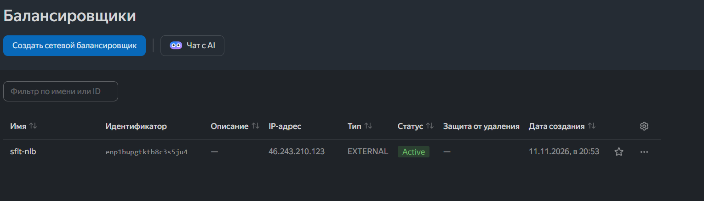
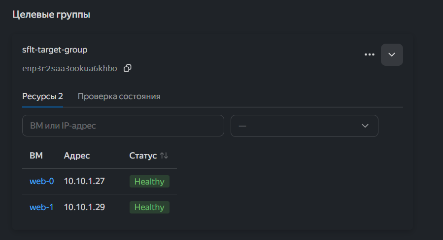
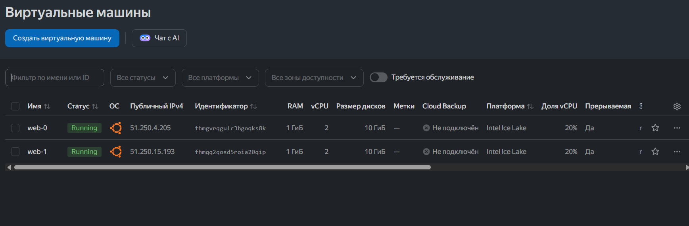
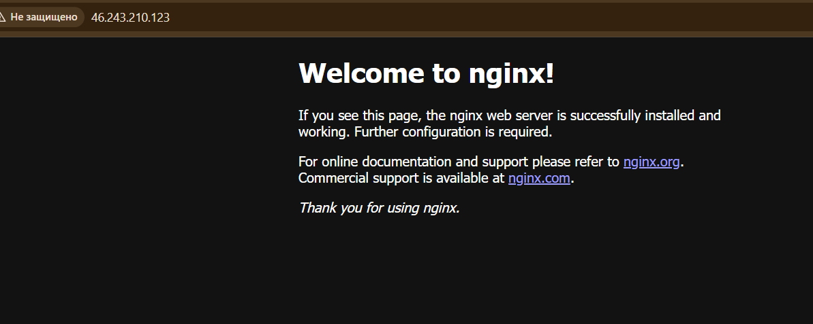

# Домашнее задание к занятию «Отказоустойчивость в облаке» — Корченко Леонид

### Задание 1

Сделал terraform playbook для Yandex Cloud. Что он создаёт:

- сеть и подсеть 10.10.1.0/24
- security group — открыл 80 и 22 порты, плюс разрешил healthcheck от балансировщика (без этого ВМ были бы unhealthy)
- 2 одинаковые ВМ web-0 и web-1 через `count = 2`
- target group, в неё добавлены обе ВМ
- сетевой балансировщик, слушает 80 порт и отправляет трафик на 80 порт ВМ, healthcheck по http на 80

Nginx ставится сразу при создании ВМ через cloud-init (cloud-init.yml).

Файлы:
- [providers.tf](providers.tf)
- [network.tf](network.tf)
- [vms.tf](vms.tf)
- [lb.tf](lb.tf)
- [cloud-init.yml](cloud-init.yml)

Подключался к облаку через сервисный аккаунт и авторизованный ключ — через OAuth токен не получилось, Яндекс новые токены для terraform больше не принимает. Ключ лежит вне репозитория.

Запуск:

```
terraform init
terraform plan
terraform apply
```

Балансировщик в статусе Active:



Обе ВМ в целевой группе healthy:



Созданные ВМ:



Открыл IP балансировщика в браузере — дефолтная страница nginx:

# sflt-04-hw
